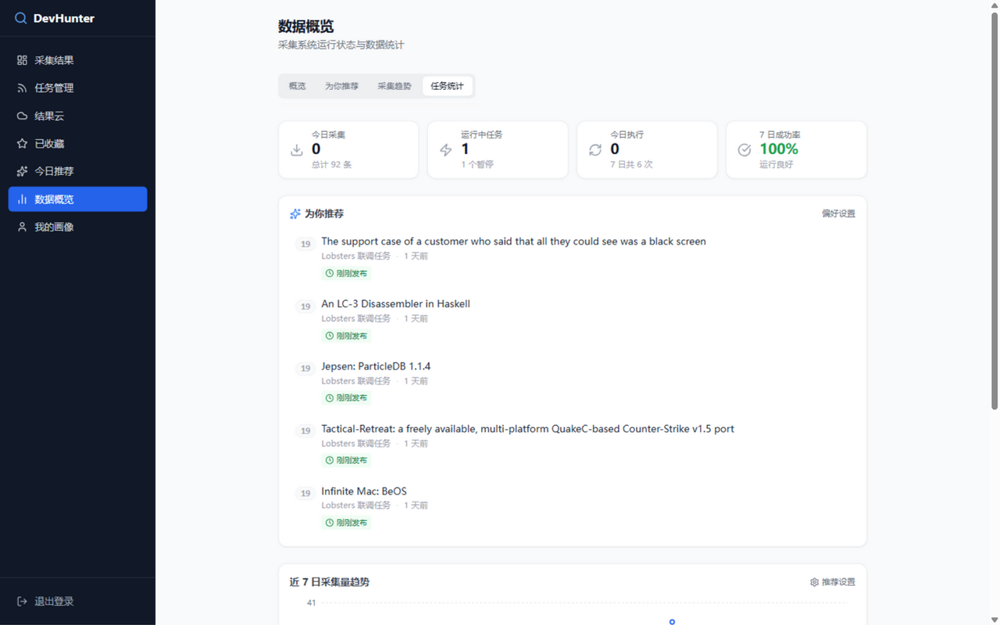
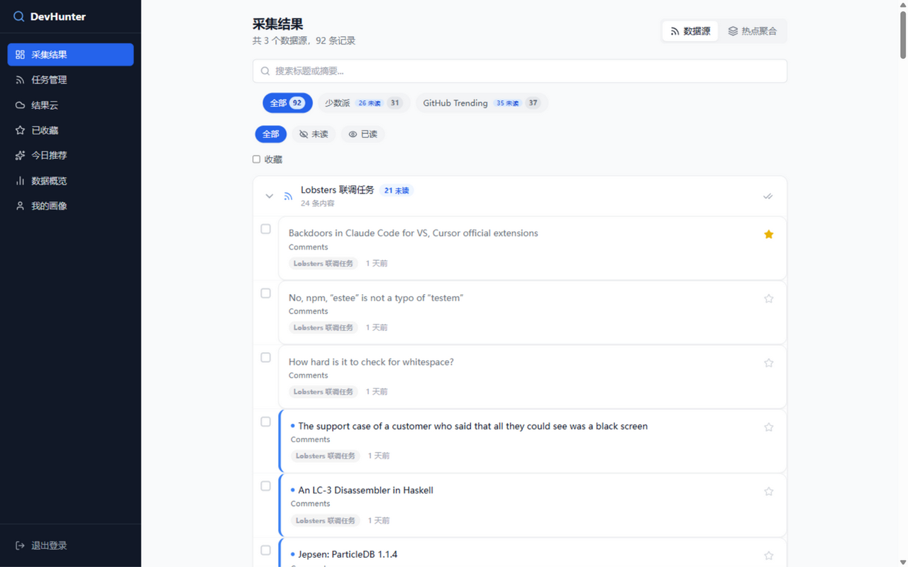
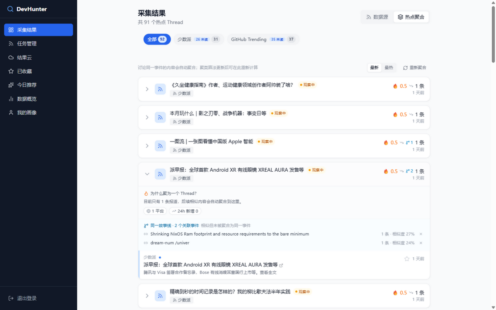
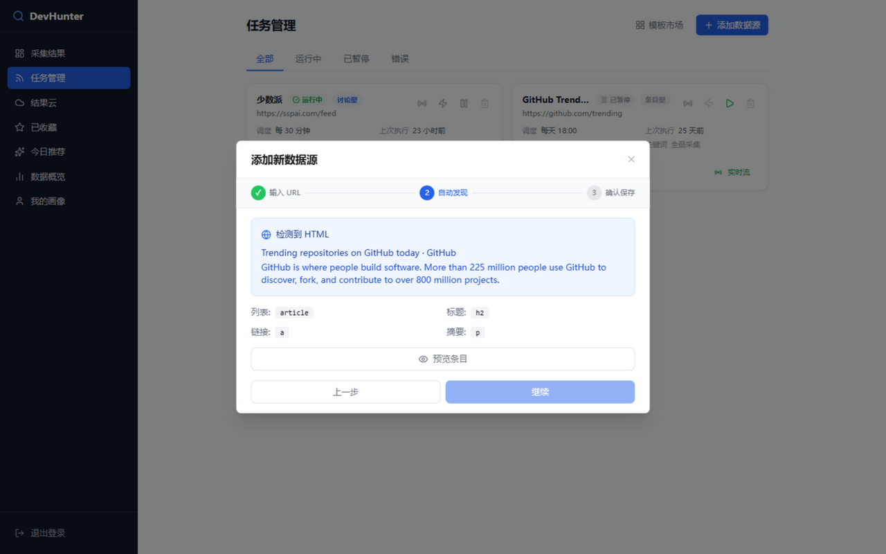
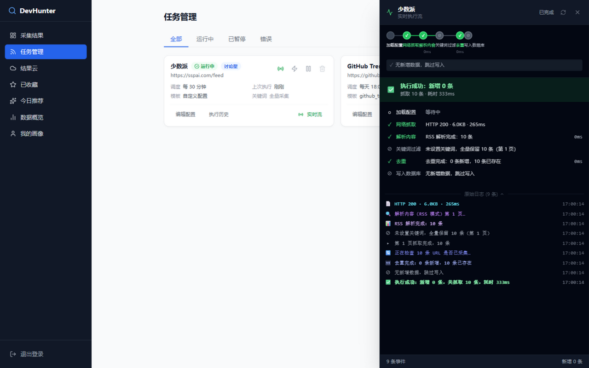
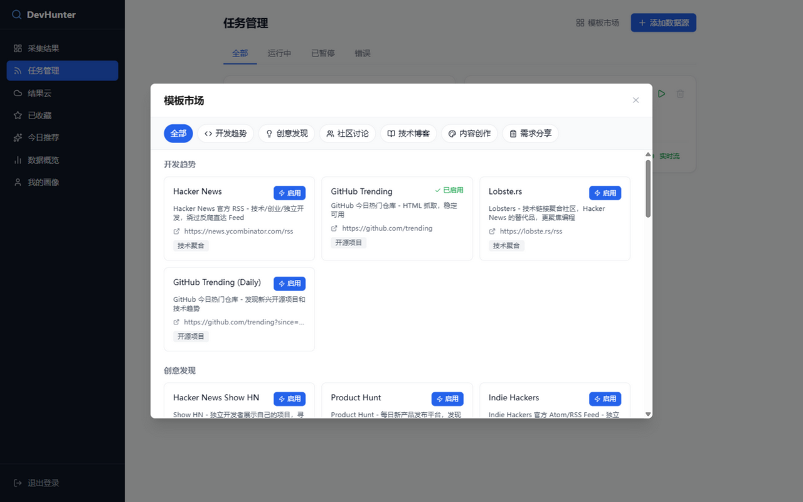
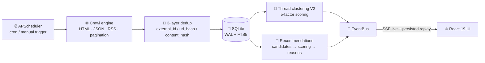

<div align="center">


# 🔍 DevHunter

**Automatic Content Aggregation & Discovery System for Developers**

Configure a crawl task once and DevHunter watches 28+ platforms for you — Hacker News, V2EX, GitHub Trending, Juejin and more. It scrapes on schedule, clusters cross-platform coverage into events, ranks them against your reading habits, keeps everything searchable, and stores 100% of the data on your own machine.

[](https://github.com/Aswellle/devhunter/actions/workflows/ci.yml)
[](https://www.python.org/)
[](https://fastapi.tiangolo.com/)
[](https://react.dev/)
[](https://www.typescriptlang.org/)
[](#license)

[Quick Start](#quick-start) · [Highlights](#highlights) · [How It Works](#how-it-works) · [Sources](#supported-sources) · [**简体中文**](./README.md)



</div>

---

## Why DevHunter

Every morning: scroll Hacker News, scroll GitHub Trending, scroll V2EX, scroll sspai — forty minutes later you're tired, you remember nothing, and **the same story was posted on three platforms while yesterday's important discussion is gone forever.**

RSS readers don't solve it (many platforms have no feed, and there's no dedup or search). Bookmarks don't solve it (nothing ever comes back out). So DevHunter exists:

> **Turn "manually browsing ten sites a day" into "configure once, then open one page."** Fetching, dedup, clustering and ranking run automatically, and the data lives in your own SQLite file.

It's not another scraping framework — it's a **complete, batteries-included system**: scheduling, live execution monitoring, clustering, recommendations, search and RSS feeds are all wired up.

---

## 📸 Screenshots

<table>
  <tr>
    <td width="50%" align="center">
      <br/>
      <sub><b>📥 Items</b> · search / filters / grouped by source</sub>
    </td>
    <td width="50%" align="center">
      <br/>
      <sub><b>🧵 Hot threads</b> · thread detail / hotness / storyline relations</sub>
    </td>
  </tr>
  <tr>
    <td width="50%" align="center">
      <br/>
      <sub><b>🧙 Wizard</b> · auto-discovery, zero selector knowledge</sub>
    </td>
    <td width="50%" align="center">
      <br/>
      <sub><b>⚡ Execution stream</b> · every step over SSE + raw log</sub>
    </td>
  </tr>
  <tr>
    <td width="50%" align="center">
      <br/>
      <sub><b>🏪 Marketplace</b> · 25 presets, one click each</sub>
    </td>
    <td width="50%" align="center">
      <br/><br/>
      <b>🌐 Plus 25 preset templates ready to go</b><br/>
      <sub>Hacker News · GitHub Trending · V2EX · Juejin<br/>sspai · Bilibili · Zhihu · Product Hunt · Reddit …</sub><br/><br/>
      <a href="#quick-start"><b>Get started →</b></a><br/><br/>
    </td>
  </tr>
</table>

---

## Highlights

### 📥 Multi-source crawling, configured once

25 preset templates for one-click onboarding (Hacker News, GitHub Trending, V2EX, Juejin, sspai, Product Hunt, Reddit…), plus fully custom sites. 5-field cron scheduling, manual trigger, automatic retries, multiple fetch modes (HTML selector / JSON API / RSS), automatic pagination — crawling is no longer your problem.

### 🧵 Cross-platform thread aggregation

Multi-factor scoring (lexical + entity + semantic + temporal + source) merges coverage of the same event into one thread — the HN discussion, the GitHub repo and the blog write-up in a single view. Every thread carries live hotness (24h half-life), lifecycle status, an AI digest, and explicit links to near-miss "same storyline" events you can unlink with one click.

### 🧙 Three-step wizard, zero selector knowledge

Enter a URL → auto-discover the content structure (including JSON paths) → preview and save. If you can paste a URL, you can configure a crawl.

### ⚡ Live execution stream

Trigger a task and SSE streams every step — fetch → parse → filter → dedup → save — with HTTP status, timings, parsed counts and dedup results. Automatic reconnection and persisted events for replay.

### 🏪 Template marketplace

Share your tuned crawl configs as templates and enable community templates with one click. Already-enabled templates are marked automatically so you can't create duplicates.

### 🎯 Explainable recommendations that improve with use

A recommendation pipeline of candidates → multi-factor scoring → diversification → **stated reasons**. The labeling assistant on the profile page shows why each item surfaced and lets you score simple pairwise preferences. The dashboard's daily picks and trend chart keep the system transparent (see the hero screenshot).

---

## Quick Start

### Option 1: Docker Compose (recommended)

```bash
git clone https://github.com/Aswellle/devhunter.git && cd devhunter
cp .env.example .env      # set AUTH_PASSWORD and SECRET_KEY (openssl rand -hex 32)
docker compose up -d
```

Open **http://localhost** and sign in with the password from `.env`. The production startup refuses placeholder credentials.

Common commands:

```bash
docker compose logs -f backend     # backend logs
docker compose up -d --build       # rebuild after updates
docker compose down                # stop (data volume is kept)
```

Port 80 taken? Change the frontend `ports` mapping in `docker-compose.yml` to `"8080:80"` and set `CORS_ORIGINS` to `http://localhost:8080`.

### Option 2: Local development

```bash
# Backend (Python 3.11+)
cd backend
pip install -r requirements.txt
cp .env.example .env        # adjust AUTH_PASSWORD / APP_PORT
python run.py               # API: http://127.0.0.1:18100 · docs: /docs

# Frontend (Node.js 18+)
cd frontend
npm install
npm run dev                 # UI: http://127.0.0.1:5200
```

> The dev server proxies `/api` to the backend port from `backend/.env` (see `frontend/vite.config.ts`) — if you change the backend port, update the proxy target too. On Windows, run `start.bat` to launch both.

---

## How It Works



**Data flow**: API routes → services → repositories → SQLite. The scheduler runs on its own thread with the **database as the single source of truth** (all schedules are restored from the DB on restart).

**Crawl engine**: four parse modes (HTML / `json:` GET / `json-post:` POST / `rss:`), exponential-backoff retries (POST 5xx is never retried to avoid duplicate side effects), SSRF protection (private/loopback/metadata ranges blocked, fail-closed DNS, per-hop redirect re-validation) and response size caps.

**Dedup**: three layers — source-native ID (per task) → URL hash (global) → content fingerprint (SHA256 of title+summary).

**Thread scoring**:

```
score = 0.30·lexical + 0.25·entity + 0.20·semantic + 0.15·temporal + 0.10·source
```

**Stack**: FastAPI + APScheduler + SQLite (WAL/FTS5) · React 19 + Vite + TypeScript + TanStack Query + Tailwind CSS · Docker Compose + Nginx

---

## Supported Sources

**25 preset templates**, grouped by category; fully custom sources work too (paste any URL, auto-discover the structure).

<details>
<summary><b>Expand all 25 preset templates</b></summary>

### Dev trends

| Template | Platform | Mode | Notes |
|----------|----------|------|-------|
| `hackernews` | Hacker News | RSS | Tech / startup / indie aggregator |
| `github_trending` | GitHub Trending | HTML | Today's popular repositories |
| `trending_github_repos` | GitHub Trending (Daily) | HTML | Daily trending repos |
| `lobsters` | Lobste.rs | RSS | Tech link aggregation |

### Idea discovery

| Template | Platform | Mode | Notes |
|----------|----------|------|-------|
| `hackernews_show` | Hacker News Show HN | RSS | Indie makers showing projects |
| `producthunt` | Product Hunt | RSS | Daily product launches |
| `indiehackers` | Indie Hackers | RSS | Indie products and discussions |
| `v2ex_create` | V2EX Create | JSON API | Developers sharing projects and ideas |
| `reddit_sideproject` | Reddit r/SideProject | JSON API | Side projects from makers |

### Community

| Template | Platform | Mode | Notes |
|----------|----------|------|-------|
| `v2ex` | V2EX Hot | JSON API | Real-time hot topics |
| `reddit_webdev` | Reddit r/webdev | JSON API | Web development |
| `reddit_startups` | Reddit r/startups | JSON API | Startups and business models |

### Tech blogs

| Template | Platform | Mode | Notes |
|----------|----------|------|-------|
| `devto` | Dev.to | JSON API | Trending articles |
| `hashnode` | Hashnode | JSON API (POST) | Developer blogging platform |
| `juejin` | Juejin | JSON API (POST) | Recommended feed (anti-bot headers) |
| `sspai` | sspai | RSS | Tech / productivity / indie tools |
| `medium_programming` | Medium Programming | RSS | In-depth engineering posts |

### Content creation

| Template | Platform | Mode | Notes |
|----------|----------|------|-------|
| `bilibili_comprehensive` | Bilibili General | JSON API | Trending videos |
| `bilibili_music` | Bilibili Music | JSON API | Trending music videos |
| `douyin_trending` | Douyin Hot | JSON API | Short-video trends |
| `zhihu_hot` | Zhihu Hot | JSON API | Real-time hot questions |

### Requests & jobs

| Template | Platform | Mode | Notes |
|----------|----------|------|-------|
| `v2ex_jobs` | V2EX Jobs | JSON API | Job postings |
| `reddit_forhire` | Reddit r/forhire | JSON API | Freelance gigs |
| `reddit_ideas` | Reddit r/SomebodyMakeThis | JSON API | Users posting product requests |
| `hackernews_ask` | Hacker News Ask HN | RSS | Ask HN |

</details>

---

## Typical Use Cases

| Scenario | Configuration | What you get |
|----------|---------------|--------------|
| **Daily tech briefing** | 3 tasks for HN, GitHub Trending and V2EX, cron `0 9 * * *` | Open one page in the morning; everything is already stored and searchable |
| **Topic tracking** | Keywords (`rust`, `llm`, `saas`) + cross-platform sources | Keyword filtering + thread clustering — one view per event |
| **Idea radar** | Subscribe to `reddit_ideas`, `v2ex_create`, `indiehackers` | Product ideas mined from real complaints and requests |
| **Creator research** | Bilibili / Douyin / Zhihu hot-list templates | A material pool with full-text recall |
| **Tech radar** | GitHub Trending + Lobste.rs + Medium | Watch ecosystem heat shift instead of guessing |

---

## Feature Overview

| Feature | Notes |
|---------|-------|
| 📥 Task management | CRUD with 25 one-click preset templates |
| 🧙 3-step wizard | Automatic structure discovery, no CSS Selector needed |
| 🏪 Template marketplace | Share & import, duplicate enablement blocked |
| ⏰ Scheduling | 5-field cron (UTC) + manual trigger |
| 🌐 Crawl engine | HTML / JSON API (GET & POST) / RSS, pagination and retries |
| 🔗 Thread aggregation V2 | 5-factor clustering + hotness momentum + lifecycle + storyline relations |
| 🎯 Recommendations | Multi-factor scoring → diversification → explainable reasons + labeling assistant |
| 🔍 Full-text search | SQLite FTS5 with LIKE fallback |
| 📊 Live execution monitor | SSE full-chain events + history + replay |
| 🏥 Source health | Availability + parse success + field coverage + freshness |
| ⭐ Star & read state | Batch ops, filters, RSS feed output |
| 🔐 Single-user auth | JWT httpOnly cookie + rate limiting + lockout |

---

## Environment Variables

See [`backend/.env.example`](backend/.env.example) (local run) and [`.env.example`](.env.example) (Docker Compose reads `AUTH_PASSWORD` and `SECRET_KEY`). All loaded by `pydantic-settings`, case-insensitive.

| Variable | Default | Notes |
|----------|---------|-------|
| `APP_ENV` | `development` | `development` / `production`; production rejects placeholder secrets |
| `APP_HOST` / `APP_PORT` | `0.0.0.0` / `8000` | Backend bind address and port |
| `AUTH_USERNAME` | `admin` | JWT subject / display name |
| `AUTH_PASSWORD` | `devhunter123` | Login password (plaintext compare), **change it** |
| `SECRET_KEY` | `change-me-in-production` | JWT signing key, **change it** (`openssl rand -hex 32`) |
| `DB_PATH` | `data/devhunter.db` | SQLite path (fixed to `/data/devhunter.db` in Docker) |
| `CRAWLER_TIMEOUT` | `15.0` | Per-request timeout (seconds) |
| `CRAWLER_MAX_RESPONSE_MB` | `5` | Response size cap |
| `SCHEDULER_MAX_WORKERS` | `3` | Scheduler workers |
| `LOG_LEVEL` / `LOG_FORMAT` | `INFO` / `json` | Logging level and format |
| `CORS_ORIGINS` | `http://localhost:5200,...` | Allowed frontend origins, comma-separated |

---

## Development & Testing

```bash
# Backend tests (410+ cases)
cd backend
pytest                                   # full suite
pytest tests/test_crawler/               # single module
pytest --cov=app --cov-report=term       # with coverage
python e2e_test.py                       # standalone E2E (self-contained temp DB)

# Frontend
npm run dev      # dev server (:5200)
npm run build    # production build (tsc -b && vite build)
npm run lint     # ESLint
```

Every push runs the full CI gate: backend tests + standalone E2E + frontend lint/build — green only when all pass.

## Security Notes

DevHunter uses a **single-user auth** model, designed for self-hosting behind a LAN or reverse proxy:

- The login password comes from an environment variable (plaintext compare) — **change it before deploying**; production startup rejects placeholders
- JWT is delivered via an **httpOnly cookie** (the response body never contains the token)
- Login rate limiting (5/min) with account lockout after repeated failures
- Built-in SSRF protection: private/loopback/link-local and cloud-metadata addresses are blocked, DNS failures fail closed, and redirects are re-validated hop by hop
- Nginx sets `X-Frame-Options`, `X-Content-Type-Options`, `Referrer-Policy` and other baseline headers

Before exposing to the public internet, add access control and HTTPS at the reverse proxy (and enable `Secure` on the cookie).

---

## ⭐ Support the Project

If DevHunter saves you the daily site-scrolling, please give it a ⭐️ — it keeps the project moving and helps other self-hosters find it.

---

## Legal & Disclaimer

DevHunter is an **information aggregation tool** intended for lawful aggregation and personal knowledge management. Respect the terms of service and `robots.txt` of any site you crawl, keep request rates reasonable, and never use it for large-scale unauthorized scraping.

👉 **For the full obligations, prohibited uses, risk notes and limitation of liability, [read LEGAL.md](LEGAL.md)** — it is versioned with the project and worth a full read before you deploy.

---

## License

[MIT](LICENSE)
