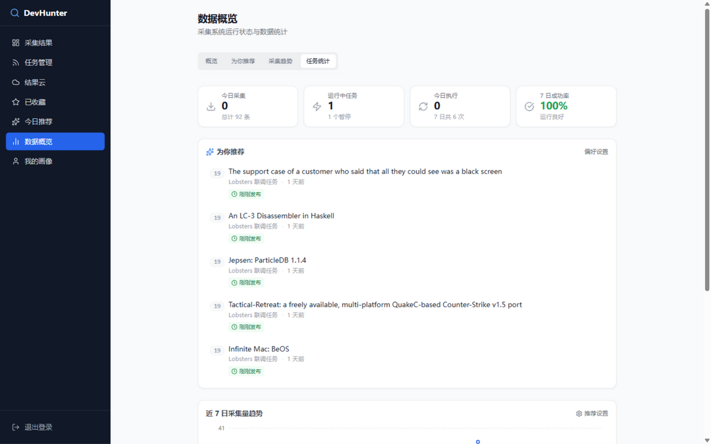
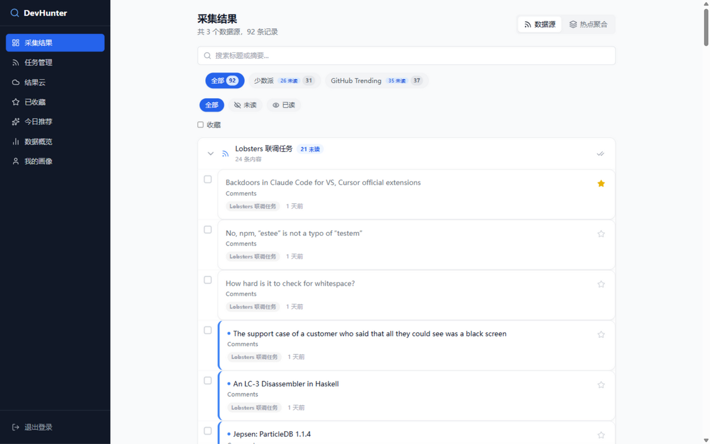
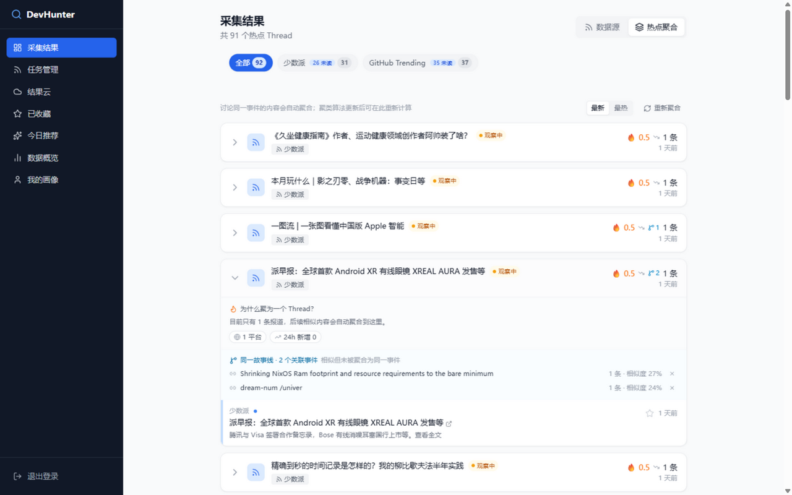
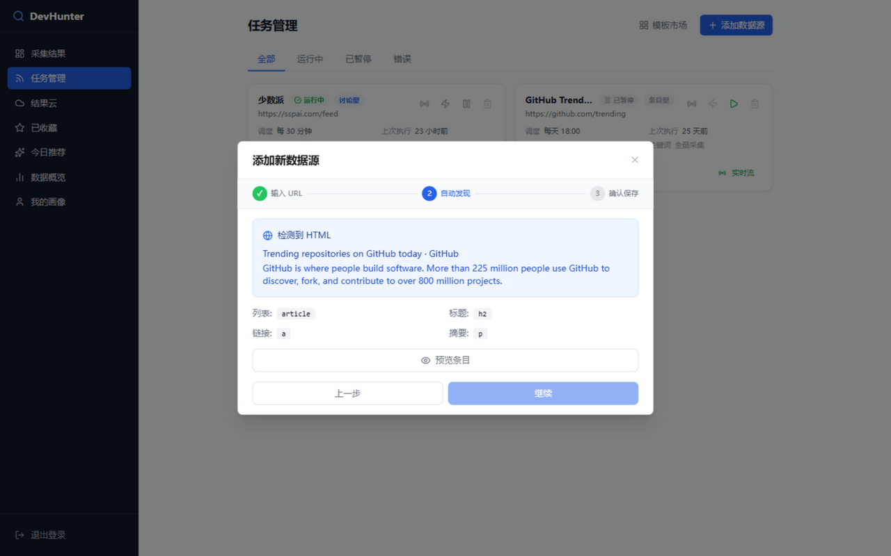
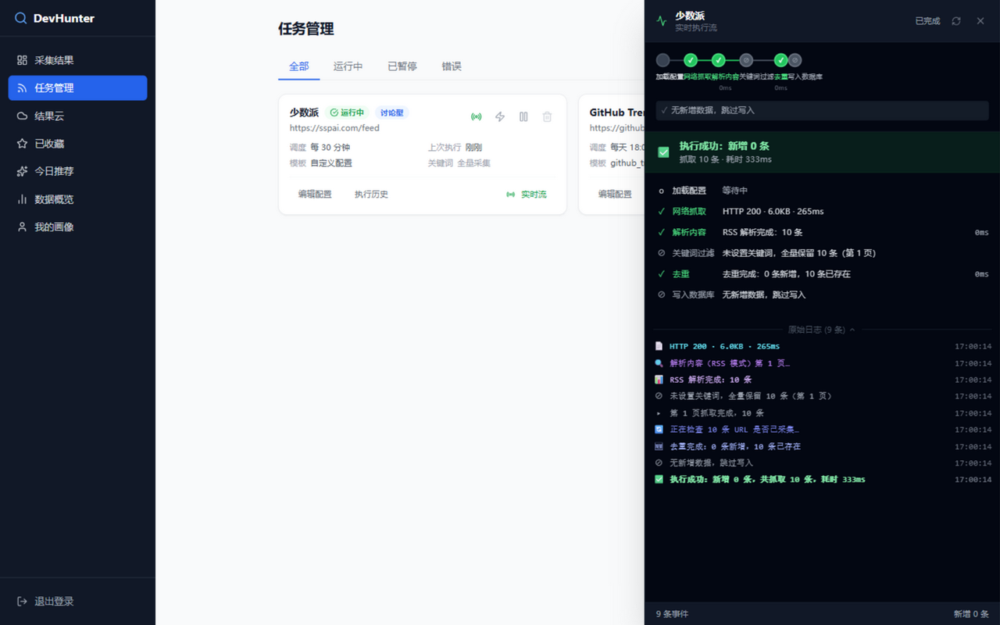
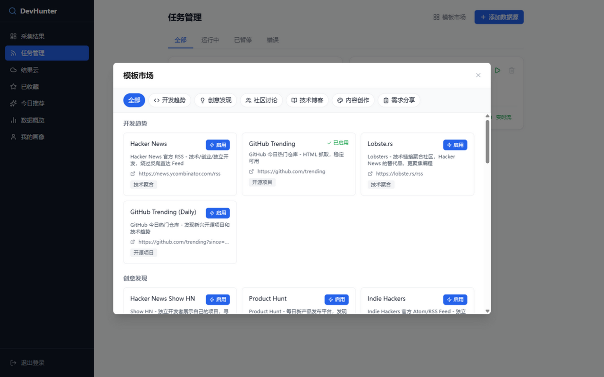
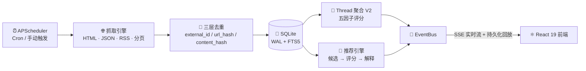

<div align="center">


# 🔍 DevHunter

**全网开发需求与创意自动采集系统**

配置一次采集任务，DevHunter 按计划替你盯住 Hacker News、V2EX、GitHub Trending、掘金等 28+ 平台——自动抓取、跨平台聚合为事件、按你的阅读习惯排序，全文可搜索，数据 100% 留在自己手里。

[](https://github.com/Aswellle/devhunter/actions/workflows/ci.yml)
[](https://www.python.org/)
[](https://fastapi.tiangolo.com/)
[](https://react.dev/)
[](https://www.typescriptlang.org/)
[](#license)

[快速启动](#快速启动) · [功能亮点](#功能亮点) · [工作原理](#工作原理) · [数据源](#支持的数据源) · [**English**](./README.en.md)



</div>

---

## 为什么做 DevHunter

每天早上打开浏览器：Hacker News 刷一遍，GitHub Trending 刷一遍，V2EX 刷一遍，少数派再刷一遍——四十分钟后，信息没记住多少，人已经疲了。更糟的是：**同一条消息在三个平台各说一遍，而你昨天看过的重要讨论，今天再也找不回来。**

RSS 阅读器解决不了（很多平台没有 Feed，也没有去重和搜索），收藏夹解决不了（进去就再也没出来过）。所以有了 DevHunter：

> **把"每天手动刷十个网站"变成"配置一次，之后只需要打开一个页面"。** 抓取、去重、聚合、排序全部自动，数据在你自己的 SQLite 里。

它不是又一个爬虫框架，而是**开箱即用的完整系统**：调度、执行监控、聚类、推荐、搜索、订阅，全都装好了。

---

## 📸 界面一览

<table>
  <tr>
    <td width="50%" align="center">
      <br/>
      <sub><b>📥 采集结果</b> · 搜索 / 多维筛选 / 按源分组</sub>
    </td>
    <td width="50%" align="center">
      <br/>
      <sub><b>🧵 热点聚合</b> · Thread 详情 / 热度动量 / 故事线关联</sub>
    </td>
  </tr>
  <tr>
    <td width="50%" align="center">
      <br/>
      <sub><b>🧙 三步向导</b> · 自动发现结构，零 Selector 知识</sub>
    </td>
    <td width="50%" align="center">
      <br/>
      <sub><b>⚡ 实时执行流</b> · SSE 全链路步骤 + 原始日志</sub>
    </td>
  </tr>
  <tr>
    <td width="50%" align="center">
      <br/>
      <sub><b>🏪 模板市场</b> · 25 个预设模板一键接入</sub>
    </td>
    <td width="50%" align="center">
      <br/><br/>
      <b>🌐 还有 25 个预设模板等你接入</b><br/>
      <sub>Hacker News · GitHub Trending · V2EX · 掘金<br/>少数派 · B 站 · 知乎 · Product Hunt · Reddit ……</sub><br/><br/>
      <a href="#快速启动"><b>立即开始 →</b></a><br/><br/>
    </td>
  </tr>
</table>

---

## 功能亮点

### 📥 多源采集，一次配置长期运行

25 个预设模板一键接入（Hacker News、GitHub Trending、V2EX、掘金、少数派、Product Hunt、Reddit……），也支持任意自定义网站。5 段 Cron 定时调度、手动一键触发、失败自动重试、多模式抓取（HTML Selector / JSON API / RSS）、自动翻页——抓取这件事你不用再管。

### 🧵 跨平台事件聚合（Threads）

多因素评分（词法 + 实体 + 语义 + 时间 + 来源）把"同一件事的多篇报道"自动归并为一个 Thread：HN 的讨论、GitHub 的仓库、博客的解读，一次看全貌。每个 Thread 带实时热度（24h 半衰期）、生命周期状态、AI 综述，评分接近但未合并的"同一故事线"事件也会显式关联展示，可一键解除误关联。

### 🧙 三步向导，零 Selector 知识

填一个网址 → 自动发现内容结构（含 JSON 路径与字段探测）→ 预览确认保存。不需要读文档学 CSS Selector，会贴 URL 就会配置采集。

### ⚡ 实时执行流

手动触发后，SSE 实时推送抓取 → 解析 → 过滤 → 去重 → 入库的每一步：HTTP 状态、耗时、解析条数、去重结果一目了然。断线自动重连，事件持久化可回放。

### 🏪 模板市场

把调好的采集配置分享成模板，也可以一键启用社区模板。已启用的模板自动标记，不会重复创建。

### 🎯 越用越准的推荐（可解释）

基于阅读行为的推荐引擎：候选 → 多因子评分 → 多样性处理 → **给出推荐理由**。配合画像页的标注助手，你可以看到每一条"为什么给你看这个"，还有简单的胜负标注来量化推荐质量。仪表盘的「为你推荐」卡片与趋势图让系统状态一目了然（见首屏截图）。

---

## 快速启动

### 方式一：Docker Compose（推荐）

```bash
git clone https://github.com/Aswellle/devhunter.git && cd devhunter
cp .env.example .env      # 填入 AUTH_PASSWORD 与 SECRET_KEY（openssl rand -hex 32）
docker compose up -d
```

打开 **http://localhost**，用 `.env` 里的密码登录。生产环境启动时会校验占位符配置并拒绝启动。

常用命令：

```bash
docker compose logs -f backend     # 查看后端日志
docker compose up -d --build       # 代码更新后重建
docker compose down                # 停止（数据卷保留）
```

宿主机 80 端口被占用？把 `docker-compose.yml` 里 frontend 的 `ports` 改成 `"8080:80"`，同时把 `CORS_ORIGINS` 改成 `http://localhost:8080`。

### 方式二：本地开发（前后端分离）

```bash
# 后端（Python 3.11+）
cd backend
pip install -r requirements.txt
cp .env.example .env        # 按需修改 AUTH_PASSWORD / APP_PORT
python run.py               # API: http://127.0.0.1:18100 · 文档: /docs

# 前端（Node.js 18+）
cd frontend
npm install
npm run dev                 # 界面: http://127.0.0.1:5200
```

> 开发服务器把 `/api` 代理到 `backend/.env` 的 `APP_PORT`（见 `frontend/vite.config.ts`）——改了后端端口必须同步修改代理目标。Windows 用户可直接运行根目录 `start.bat` 一键启动。

---

## 工作原理



**数据流**：API 路由 → 服务层 → 仓储层 → SQLite；调度器跑在独立线程，任务状态以**数据库为唯一真相源**（进程重启后自动恢复全部调度）。

**抓取引擎**：四种解析模式（HTML / `json:` GET / `json-post:` POST / `rss:`），自动重试（指数退避，POST 5xx 不重试防重复副作用），内置 SSRF 防护（私有网段/环回/云元数据地址拦截，DNS 失败 fail-closed，重定向逐跳重校验），响应大小上限保护。

**去重**：三层递进——来源原生 ID（按任务）→ URL hash（全局）→ 内容指纹（title+summary SHA256）。

**Thread 聚合评分**：

```
score = 0.30·词法 + 0.25·实体 + 0.20·语义 + 0.15·时间 + 0.10·来源
```

**技术栈**：FastAPI + APScheduler + SQLite（WAL/FTS5） · React 19 + Vite + TypeScript + TanStack Query + Tailwind CSS · Docker Compose + Nginx

---

## 支持的数据源

内置 **25 个预设模板**，按类别分组；也支持完全自定义（填入任意 URL，自动发现结构）。

<details>
<summary><b>展开全部 25 个预设模板</b></summary>

### 开发趋势

| 模板 | 平台 | 抓取方式 | 说明 |
|------|------|----------|------|
| `hackernews` | Hacker News | RSS | 技术/创业/独立开发聚合 |
| `github_trending` | GitHub Trending | HTML | 今日热门开源仓库 |
| `trending_github_repos` | GitHub Trending (Daily) | HTML | 每日热门仓库 |
| `lobsters` | Lobste.rs | RSS | 技术链接聚合社区 |

### 创意发现

| 模板 | 平台 | 抓取方式 | 说明 |
|------|------|----------|------|
| `hackernews_show` | Hacker News Show HN | RSS | 独立开发者展示项目 |
| `producthunt` | Product Hunt | RSS | 每日新产品发布 |
| `indiehackers` | Indie Hackers | RSS | 独立开发者产品与讨论 |
| `v2ex_create` | V2EX 创意分享 | JSON API | 开发者分享项目和创意 |
| `reddit_sideproject` | Reddit r/SideProject | JSON API | 开发者分享副项目和创意 |

### 社区讨论

| 模板 | 平台 | 抓取方式 | 说明 |
|------|------|----------|------|
| `v2ex` | V2EX 热门 | JSON API | 实时热门话题 |
| `reddit_webdev` | Reddit r/webdev | JSON API | Web 开发讨论 |
| `reddit_startups` | Reddit r/startups | JSON API | 创业讨论和商业模式 |

### 技术博客

| 模板 | 平台 | 抓取方式 | 说明 |
|------|------|----------|------|
| `devto` | Dev.to | JSON API | 热门技术文章 |
| `hashnode` | Hashnode | JSON API (POST) | 开发者博客平台 |
| `juejin` | 掘金推荐 | JSON API (POST) | 推荐文章流（含反爬请求头） |
| `sspai` | 少数派 | RSS | 科技/效率/独立开发工具 |
| `medium_programming` | Medium Programming | RSS | 技术深度文章 |

### 内容创作

| 模板 | 平台 | 抓取方式 | 说明 |
|------|------|----------|------|
| `bilibili_comprehensive` | 哔哩哔哩 综合 | JSON API | 综合区热门视频素材 |
| `bilibili_music` | 哔哩哔哩 音乐 | JSON API | 音乐区热门视频素材 |
| `douyin_trending` | 抖音 热门 | JSON API | 短视频热门话题与趋势 |
| `zhihu_hot` | 知乎 热榜 | JSON API | 实时热门话题和讨论 |

### 需求分享

| 模板 | 平台 | 抓取方式 | 说明 |
|------|------|----------|------|
| `v2ex_jobs` | V2EX 工作 | JSON API | 工作机会和招聘 |
| `reddit_forhire` | Reddit r/forhire | JSON API | 自由职业项目机会 |
| `reddit_ideas` | Reddit r/SomebodyMakeThis | JSON API | 用户发布创意需求 |
| `hackernews_ask` | Hacker News Ask HN | RSS | 开发者提问和寻求建议 |

</details>

---

## 典型使用场景

| 场景 | 配置方式 | 你得到什么 |
|------|----------|------------|
| **每日技术晨报** | 3 个任务分别抓 Hacker News、GitHub Trending、V2EX，Cron `0 9 * * *` | 早上打开一次，三个平台的当日重点已入库，可搜索 |
| **主题追踪** | 关键词（如 `rust`、`llm`、`saas`）+ 跨平台来源 | 关键词命中过滤 + Thread 聚合，同一事件跨平台一次看完 |
| **需求 / 灵感雷达** | 订阅 `reddit_ideas`、`v2ex_create`、`indiehackers` | 从别人的吐槽和创意里找可做的产品点 |
| **创作者选题库** | 订阅 B 站 / 抖音 / 知乎热榜类模板 | 热榜素材池 + 全文回溯，选题不再靠刷手机 |
| **技术雷达** | GitHub Trending + Lobste.rs + Medium | 观察生态热度变化，而不是凭印象选型 |

---

## 功能总览

| 功能 | 说明 |
|------|------|
| 📥 采集任务管理 | 创建 / 编辑 / 删除，25 个预设模板一键接入 |
| 🧙 3 步模板向导 | URL 自动发现结构，无需手写 CSS Selector |
| 🏪 模板市场 | 分享与一键导入，自动防重复启用 |
| ⏰ 定时调度 | 5 段 Cron（UTC），分钟级精度 + 手动触发 |
| 🌐 多模式抓取引擎 | HTML / JSON API (GET & POST) / RSS，自动分页与重试 |
| 🔗 跨平台聚合 V2 | 五因子聚类 + 热度动量 + 生命周期 + 故事线关联 |
| 🎯 个性化推荐 | 多因子评分 → 多样性 → 可解释理由 + 标注助手 |
| 🔍 全文搜索 | SQLite FTS5，语法错误自动回退 LIKE |
| 📊 实时执行监控 | SSE 全链路事件 + 执行历史 + 断线重放 |
| 🏥 来源健康监控 | 可用性 + 解析成功率 + 字段覆盖率 + 新鲜度 |
| ⭐ 收藏与已读 | 批量操作、多维度筛选、RSS 订阅出口 |
| 🔐 单用户认证 | JWT httpOnly Cookie + 登录限流 + 账户锁定 |

---

## 环境变量

完整列表见 [`backend/.env.example`](backend/.env.example)（本地运行）与根目录 [`.env.example`](.env.example)（Docker Compose 只读取 `AUTH_PASSWORD` 与 `SECRET_KEY`）。全部由 `pydantic-settings` 读取，大小写不敏感。

| 变量 | 默认值 | 说明 |
|------|--------|------|
| `APP_ENV` | `development` | `development` / `production`；生产环境拒绝占位符敏感配置 |
| `APP_HOST` / `APP_PORT` | `0.0.0.0` / `8000` | 后端绑定地址与端口（`backend/.env.example` 示例为 `18100`） |
| `AUTH_USERNAME` | `admin` | 单用户模式下的 JWT 主体 / 显示名 |
| `AUTH_PASSWORD` | `devhunter123` | 登录密码（明文比对），**务必修改** |
| `SECRET_KEY` | `change-me-in-production` | JWT 签名密钥，**务必修改**（`openssl rand -hex 32`） |
| `DB_PATH` | `data/devhunter.db` | SQLite 路径（Docker 部署固定为 `/data/devhunter.db`） |
| `CRAWLER_TIMEOUT` | `15.0` | 单次抓取请求超时（秒） |
| `CRAWLER_MAX_RESPONSE_MB` | `5` | 响应体大小上限 |
| `SCHEDULER_MAX_WORKERS` | `3` | 调度器并行 Worker 数 |
| `LOG_LEVEL` / `LOG_FORMAT` | `INFO` / `json` | 日志级别与格式 |
| `CORS_ORIGINS` | `http://localhost:5200,...` | 允许的前端来源，逗号分隔 |

---

## 开发与测试

```bash
# 后端测试（410+ 用例）
cd backend
pytest                                   # 完整套件
pytest tests/test_crawler/               # 单模块
pytest --cov=app --cov-report=term       # 带覆盖率
python e2e_test.py                       # 独立 E2E（自包含临时 DB）

# 前端
npm run dev      # 开发服务器（:5200）
npm run build    # 生产构建（tsc -b && vite build）
npm run lint     # ESLint
```

每次推送都会触发完整 CI 门禁：后端全量测试 + 独立 E2E + 前端 ESLint/构建，全部通过才算绿。

## 安全说明

DevHunter 采用**单用户认证**模型，适合自托管 / 内网 / 反向代理后使用：

- 登录密码来自环境变量（明文比对），**部署前必须修改**；生产环境启动时拒绝占位符值
- JWT 通过 **httpOnly Cookie** 下发（响应体不含 token），前端不接触凭证
- 登录接口限流（5 次/分钟），连续 5 次失败后账户锁定
- 抓取引擎内置 SSRF 防护：拒绝私有网段 / 环回 / 链路本地地址与云元数据端点，DNS 解析失败时 fail-closed，重定向逐跳重新校验
- 前端 Nginx 配置了 `X-Frame-Options`、`X-Content-Type-Options`、`Referrer-Policy` 等基础安全响应头

直接暴露到公网前，建议至少在反向代理层再加一层访问控制与 HTTPS（并为 Cookie 启用 `Secure`）。

---

## ⭐ 支持这个项目

如果 DevHunter 帮你省下了每天刷网站的时间，欢迎给一个 ⭐️ Star——这是项目持续迭代最大的动力，也让更多自托管爱好者发现它。

---

## 法律合规与免责声明

DevHunter 是一个**信息聚合工具**，仅供合法的信息聚合与个人知识管理用途。抓取前请遵守目标网站的服务条款与 `robots.txt` 指令，控制请求频率，勿用于任何未经授权的大规模抓取。

👉 **完整的使用者义务、禁止用途、风险提示与责任限制条款，请[点击查看《法律合规与免责声明》](LEGAL.md)全文**——该文档随项目一同维护，使用前建议完整阅读一次。

---

## License

[MIT](LICENSE)
